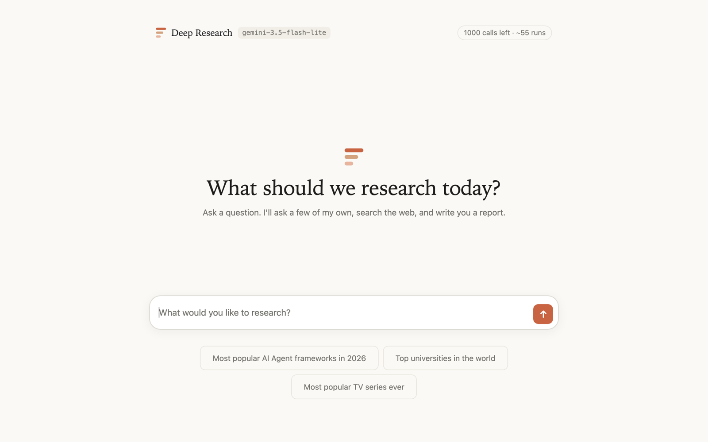

<div align="center">


# Deep Research

**Ask a question and get a long, cited report built from web sources.**

A multi-agent research assistant: it asks you a few clarifying questions, plans web searches around your answers, runs them in parallel, and writes a markdown report with IEEE or APA references.


</div>

<picture>
  <source media="(prefers-color-scheme: dark)" srcset="docs/screenshot-home-dark.png" />
  
</picture>

## What it does

1. **Clarifies.** You ask a question. The app asks you three short questions about scope, time frame or angle. Answer any of them, or skip.
2. **Plans.** A planner agent turns your query and answers into a set of targeted web searches.
3. **Searches.** Search agents run those searches in parallel and summarize what they find. A search that fails is dropped, and the rest carry on.
4. **Collects sources.** Every source page is fetched to read its title, authors, date and site name. Redirects are resolved and duplicates merged.
5. **Writes.** A writer agent drafts a long report and marks each claim with `[n]`.
6. **Cites.** The citations are formatted in Python, not by the model, so no reference is invented. The report gets in-text citations and a reference list in IEEE or APA style.

The chat-style interface shows a step-by-step progress card while it works. It has light and dark themes and works on phones.

### Highlights
- **Two providers, one switch.** `MODEL_PROVIDER=openai|gemini` swaps the whole pipeline. Gemini runs through its OpenAI-compatible endpoint, and Google Search grounding stands in for OpenAI's hosted web search tool.
- **Runs on Gemini's free tier.** Google doesn't report how much quota is left, so the app counts its own calls, throttles to the per-minute limit and refuses a run that wouldn't finish. It shows the calls left in the top bar.
- **Never a dead end.** When the search quota runs out, you can still get a report written from the model's memory. That report is clearly labeled and has no references.
- **No silent failures.** When searches find no sources, the References section says so and gives the reason (for example a `429` from Google).
- **Ready to deploy.** It comes with a Render Blueprint, an optional login, usage counts stored in Upstash Redis (which survive restarts on the free plan), and link previews for shared links.

## Tech stack

| Area | Tools |
|---|---|
| Agents | [OpenAI Agents SDK](https://openai.github.io/openai-agents-python/) (`openai-agents`), structured outputs with Pydantic |
| Models | OpenAI (`gpt-5.4-mini`) or Google Gemini (`gemini-3.5-flash-lite`) |
| Web search | OpenAI hosted `WebSearchTool`, or Google Search grounding through `google-genai` |
| UI | Gradio 6 Blocks with custom CSS/JS: chat layout, progress card, light and dark themes |
| Sources | `httpx` for page metadata (meta tags and JSON-LD); hand-written IEEE and APA formatters |
| Usage tracking | httpx event hooks, a rolling-window rate limiter, and Upstash Redis over its REST API |
| Tooling and hosting | `uv`, Python 3.12, Render (free plan) |

## Architecture


The diagram's source is [`docs/architecture.dot`](docs/architecture.dot) (Graphviz). After you edit it, render it again with `dot -Tsvg docs/architecture.dot -o docs/architecture.svg`.

| File | Role |
|---|---|
| `app.py` | Gradio chat UI: login, clarifying questions, progress card, report, usage meter |
| `research_manager.py` | Runs the pipeline and streams progress updates, then the report |
| `clarifier_agent.py`, `planner_agent.py`, `search_agent.py`, `writer_agent.py` | One agent per file: its instructions, output model, and `Agent(...)` |
| `gemini_search.py` | The `web_search` tool for Gemini (Google Search grounding) |
| `sources.py`, `citations.py` | Collect and enrich sources; format IEEE and APA citations |
| `llm_config.py` | Picks the provider and model; sets up the Gemini client |
| `usage.py` | Usage meter, rate limiter, quota checks, file or Upstash store |
| `link_preview.py` | Meta tags and the preview image for shared links |
| `styles.py` | Theme tokens, CSS, and HTML snippets for the UI and login page |
| `simple.py` | A minimal UI: query in, report out, no questions |

## Getting started

### Prerequisites
- Python 3.12 and [uv](https://docs.astral.sh/uv/getting-started/installation/)
- An API key: [Gemini](https://aistudio.google.com/apikey) (has a free tier) or [OpenAI](https://platform.openai.com/api-keys)

### 1. Clone and install
```bash
git clone https://github.com/zenthiccc/LLM-Deep-Researcher.git
cd LLM-Deep-Researcher
uv sync
```

### 2. Configure
```bash
cp .env.example .env
```
Then edit `.env`. The minimum is a provider and its key:

```dotenv
MODEL_PROVIDER=gemini          # or openai
GEMINI_API_KEY=your-key        # or OPENAI_API_KEY for openai
```

| Variable | Default | What it does |
|---|---|---|
| `MODEL_PROVIDER` | `openai` | `openai` or `gemini` |
| `OPENAI_API_KEY` / `GEMINI_API_KEY` | | The key for the chosen provider. The app stops at startup if it's missing. |
| `DEFAULT_MODEL_NAME` | `gpt-5.4-mini` / `gemini-3.5-flash-lite` | The model used by every agent |
| `HOW_MANY_SEARCHES` | `3` | Searches per report |
| `GEMINI_RPM`, `GEMINI_RPD`, `GEMINI_SEARCH_LIMIT`, `GEMINI_SEARCH_PERIOD` | unset | Your Gemini limits from AI Studio → **Rate limits**. They turn on the meter's "left" counts, throttling and run blocking. |
| `APP_USERNAME`, `APP_PASSWORD` | unset | Set both to require a login |
| `UPSTASH_REDIS_REST_URL`, `UPSTASH_REDIS_REST_TOKEN` | unset | Keep usage counts in Upstash Redis instead of `.usage.json` |
| `PUBLIC_URL` | unset | The public URL used in link previews (only needed for a custom domain) |

### 3. Run
```bash
uv run python app.py           # full chat UI at http://127.0.0.1:7860
uv run python simple.py        # minimal UI: no clarifying questions
```

Type a question, or pick one of the suggestions. Answer the questions (or click **Skip**), choose **IEEE** or **APA**, and click **Start research**. A run makes about 12 model calls with 3 searches.

### 4. Deploy on Render
`render.yaml` is a [Render Blueprint](https://render.com/docs/infrastructure-as-code) for a free web service. Render's free plan wipes the disk on every restart, so the usage counts go to a free Upstash Redis database instead.

1. Push the repo to GitHub.
2. Create a free Redis database at [upstash.com](https://upstash.com), in a region near your Render region. From its **REST API** section, copy `UPSTASH_REDIS_REST_URL` and `UPSTASH_REDIS_REST_TOKEN`.
3. In Render, click **New → Blueprint** and pick the repo. Render asks for the values marked `sync: false`:
   - `GEMINI_API_KEY`
   - `APP_USERNAME` and `APP_PASSWORD`
   - your Gemini limits
   - the two Upstash values
4. Deploy. The app is served at `https://<service>.onrender.com` and asks for the username and password.

> [!IMPORTANT]
> Without a login, anyone with the URL can spend your API quota. Set both `APP_USERNAME` and `APP_PASSWORD`. The app won't start with only one of them.

> [!NOTE]
> A free service sleeps after 15 idle minutes, so the first visit after that takes about a minute. Pushing to the deploy branch redeploys the service.

## More details

<details>
<summary><b>References (IEEE / APA)</b></summary>

Sources come from the search tools: OpenAI's `url_citation` annotations, or the sources recorded by the Gemini grounding tool. Each page is fetched for its title, authors, publication date and site name. Fields a page doesn't provide are left out, and APA shows `n.d.` for a missing date. The writer only places `[n]` markers, and `citations.py` turns them into IEEE numbers or APA author-date citations, then adds the reference list. A references section the model writes itself is removed. The report always ends with a References section. When no sources were found, that section gives the reason.
</details>

<details>
<summary><b>Free-tier usage meter (Gemini)</b></summary>

- **Meter.** The top bar shows the calls left today and about how many runs that allows. Each report ends with a usage line: calls today, searches, runs left, and the time until the daily reset (midnight Pacific).
- **Rate limiting.** Calls are spaced out to stay under `GEMINI_RPM`. Automatic retries are off, because each retry uses quota.
- **Blocking.** A run won't start when fewer calls or searches are left than it needs. The estimate is the average of your last 5 runs. A `429` from Google marks that quota as used up until it resets.
- **Without web search.** When only the search quota is used up, the notice shows a **Continue without web search** button. That run costs about 3 calls and is written from the model's memory.
- **Storage.** Counts are kept in `.usage.json` (not committed) or in Upstash Redis. To reset the meter, delete the file or the `deep-research:usage` key. Calls you make elsewhere on the same Google project aren't counted.
</details>

<details>
<summary><b>Link previews</b></summary>

A shared link shows a preview card with the title, a description, and `assets/preview.png`, even behind the login. Chat apps cache previews, so a link shared before a deploy can keep its old card for a while. Sharing `…/?v=2` gets a fresh one.
</details>
